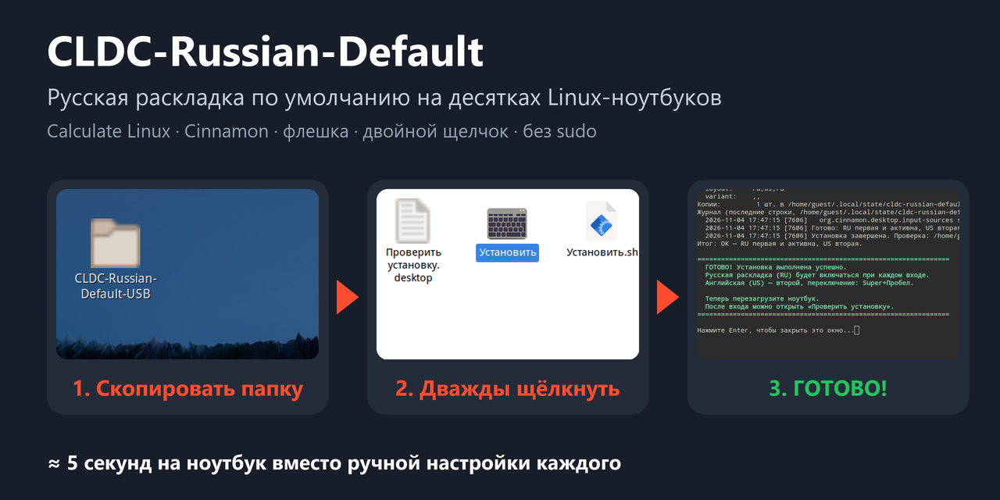
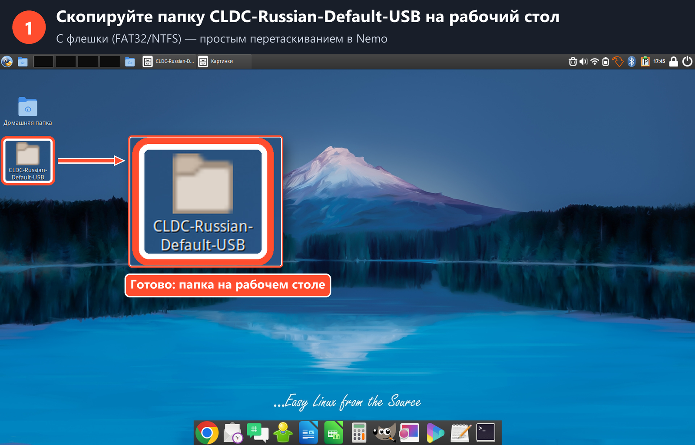
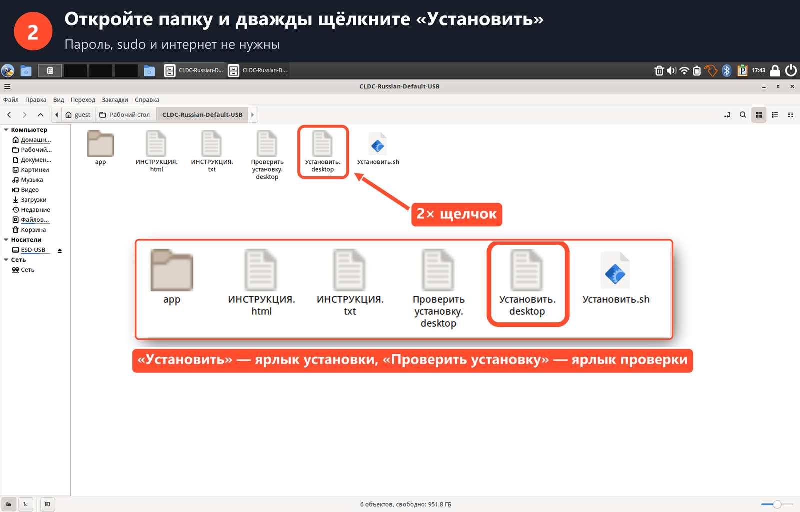
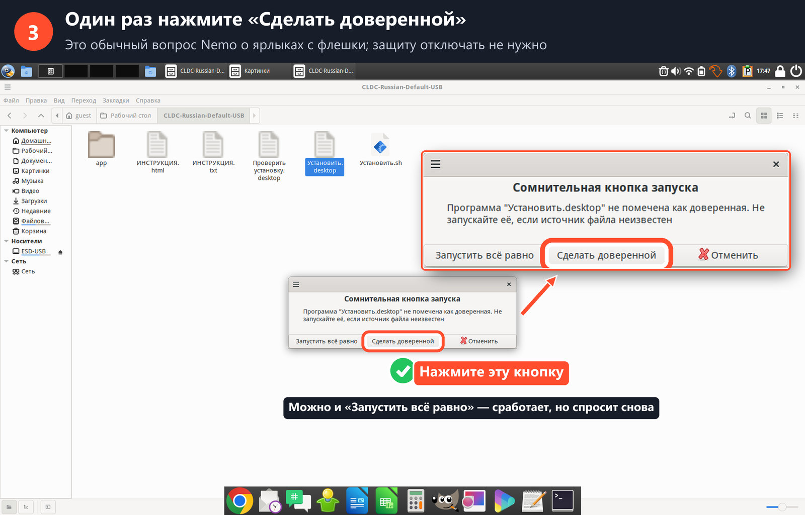
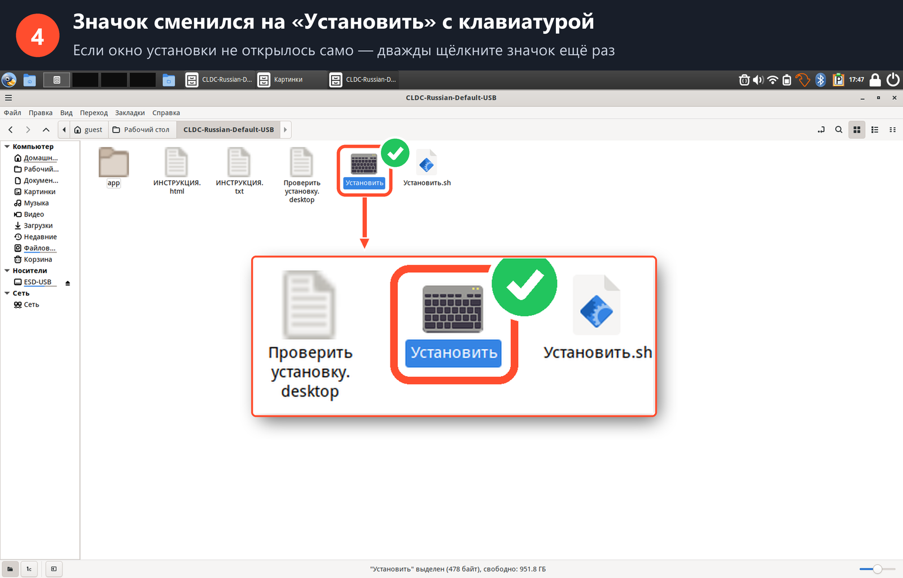
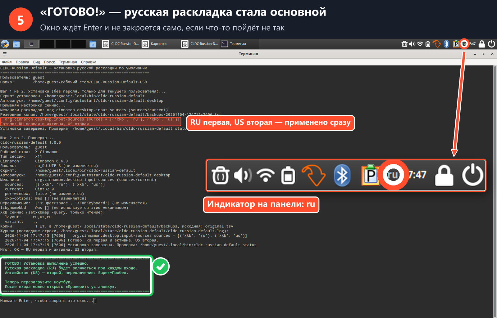
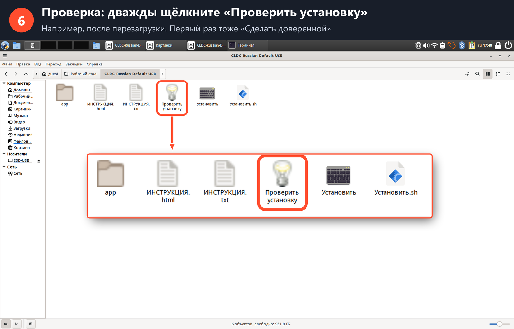
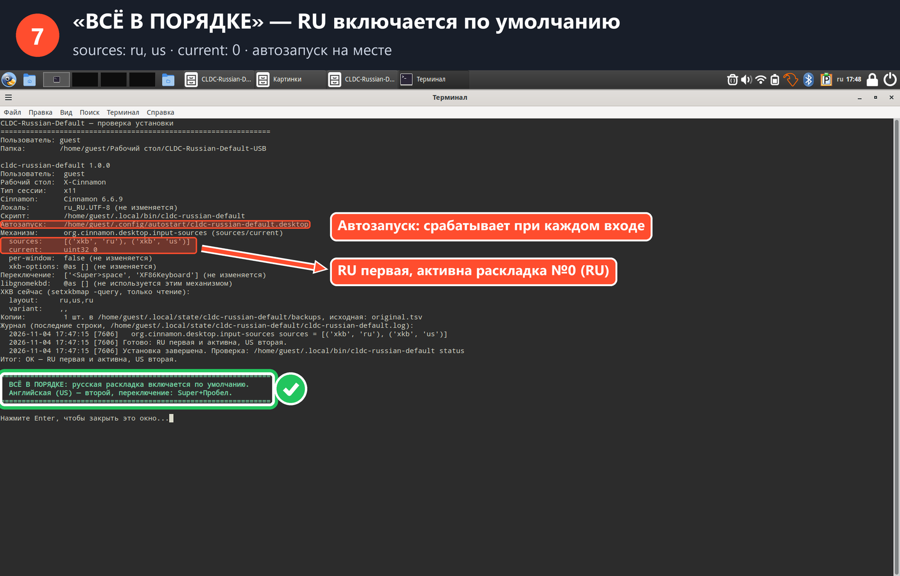

# CLDC-Russian-Default — русская раскладка по умолчанию на десятках Linux-ноутбуков

[](#совместимость)
[](#совместимость)
[](#как-это-работает)
[](#безопасность)
[](LICENSE)

**CLDC-Russian-Default** делает **русскую раскладку клавиатуры (RU) основной** в Linux
с рабочим столом **Cinnamon** (проверено на **Calculate Linux Desktop Cinnamon**). Утилита рассчитана
на **массовую подготовку компьютеров**. Её копируют на флешку, на каждом ноутбуке дважды щёлкают
«Установить», и через несколько секунд RU включается по умолчанию при каждом входе: в Chrome,
LibreOffice и других программах. Английская раскладка (US) остаётся второй, Super+Пробел
по-прежнему переключает раскладку.

<p align="center">
  
</p>

## Для кого этот проект

> [!IMPORTANT]
> Если у вас **один компьютер**, утилита не нужна. Поставить RU первой можно самому за 2–3 минуты
> (см. [ниже](#если-у-вас-один-компьютер)).

Проект сделан для тех, кто **готовит много Linux-компьютеров сразу** и хочет, чтобы на всех
была одинаковая и правильная настройка:

- **компании-поставщики и сервисные центры**, которые выдают партии ноутбуков (40 и больше);
- **школы, колледжи, библиотеки, компьютерные классы**;
- **системные администраторы** и ИТ-отделы организаций.

Вручную открывать настройки на каждом из 40 ноутбуков долго и однообразно, к тому же легко
пропустить один из них. С флешкой это один двойной щелчок на устройство, а результат
одинаковый везде, и его можно проверить.

## Возможности

- 🖱️ **Установка двойным щелчком с флешки.** Ярлыки «Установить» и «Проверить установку», итог показывается на русском.
- 🔁 **Применяется при каждом входе** через автозапуск, даже если раскладку переключили или сбросили.
- 🔐 **Без root, sudo, паролей и интернета.** Меняются только настройки текущего пользователя.
- 💾 **Резервная копия перед каждым изменением**, восстановление одной командой.
- ✅ **Безопасный повторный запуск**: если всё уже настроено, ничего не записывается.
- 🧩 **Ничего лишнего не трогает**: XKB-опции, сочетания клавиш, другие раскладки и системная локаль остаются как были.
- 🪶 **Без зависимостей**: только `bash` и `gsettings`, которые уже есть в Cinnamon.
- 💽 **Флешки из Windows (FAT32/NTFS)**: папку можно положить куда угодно, права на запуск сохранять не нужно.

## Содержание

- [Быстрый старт: установка с флешки](#быстрый-старт-установка-с-флешки)
- [Пошагово, со скриншотами](#пошагово-со-скриншотами)
- [Из личного опыта автора](#из-личного-опыта-автора)
- [Установка из терминала](#установка-из-терминала)
- [Как это работает](#как-это-работает)
- [Совместимость](#совместимость)
- [Безопасность](#безопасность)
- [Восстановление и удаление](#восстановление-и-удаление)
- [Частые вопросы и проблемы](#частые-вопросы-и-проблемы)
- [Для разработчиков](#для-разработчиков)
- [English summary](#english-summary)

## Быстрый старт: установка с флешки

1. **Скачайте** `CLDC-Russian-Default-USB.zip` со страницы [Releases](../../releases/latest)
   или соберите его сами (`bash usb/build-usb.sh`, см. [Для разработчиков](#для-разработчиков)).
2. **Распакуйте** архив на любом компьютере, в том числе на Windows, и скопируйте папку
   `CLDC-Russian-Default-USB` на обычную флешку.
3. **На каждом ноутбуке**:
   - скопируйте папку с флешки на рабочий стол;
   - дважды щёлкните **«Установить»**;
   - один раз нажмите **«Сделать доверенной»**;
   - дождитесь **«ГОТОВО!»** и нажмите Enter.
4. **Перезагрузите** ноутбук. Русская раскладка включится сама.

В папке есть подробная инструкция для неподготовленного пользователя:
`ИНСТРУКЦИЯ.html` (с картинками) и `ИНСТРУКЦИЯ.txt`.

## Пошагово, со скриншотами

Скриншоты сделаны на реальном ноутбуке: Calculate Linux Desktop Cinnamon, Cinnamon 6.6.9, X11.

<details open>
<summary><b>1. Скопируйте папку на рабочий стол</b></summary>


</details>

<details open>
<summary><b>2. Откройте папку и дважды щёлкните «Установить»</b></summary>


</details>

<details open>
<summary><b>3. Один раз нажмите «Сделать доверенной»</b></summary>

Это обычный вопрос файлового менеджера Nemo о ярлыках, скопированных с флешки.
Отключать защиту системы не нужно.


</details>

<details open>
<summary><b>4. Значок сменился на клавиатуру, установка запускается</b></summary>


</details>

<details open>
<summary><b>5. «ГОТОВО!»: RU стала основной, на панели индикатор ru</b></summary>

Окно ждёт Enter и не закроется само, если что-то пойдёт не так.


</details>

<details>
<summary><b>6–7. После перезагрузки: «Проверить установку» → «ВСЁ В ПОРЯДКЕ»</b></summary>




</details>

## Из личного опыта автора

> Я создал эту программу, когда готовил к работе партию из 30 ноутбуков «Гравитон» с Calculate
> Linux. На каждом устройстве нужно было сделать русскую раскладку основной, сохранив английскую
> для переключения.
>
> Вручную настраивать клавиатуру на каждом ноутбуке было бы однообразной и ненужной работой.
> С этой программой всё оказалось быстрее: я подключал флешку, запускал установщик — и примерно
> за 5 секунд получал готовую настройку на одном ноутбуке.
>
> В итоге удалось автоматизировать повторяющуюся скучную операцию и получить одинаковые
> настройки на всех устройствах. Это просто небольшой инструмент, который экономит время,
> избавляет от рутины и снижает вероятность ошибок при подготовке большого количества компьютеров.
>
> Именно поэтому я решил сделать проект открытым: возможно, он пригодится другим людям,
> системным администраторам, школам и компаниям, которым приходится готовить десятки
> Linux-компьютеров к работе.

## Если у вас один компьютер

Утилита не нужна. Откройте **Параметры системы → Клавиатура → Раскладки** и поднимите
«Русская» на первое место. То же самое одной командой:

```bash
gsettings set org.cinnamon.desktop.input-sources sources "[('xkb', 'ru'), ('xkb', 'us')]"
```

## Установка из терминала

Для администраторов, которым ярлыки не нужны. Достаточно одного файла `cldc-russian-default`:

```bash
bash cldc-russian-default apply --dry-run
```

```bash
bash cldc-russian-default install
```

| Команда | Что делает |
|---|---|
| `install [--no-apply]` | копирует утилиту в `~/.local/bin`, создаёт автозапуск и сразу применяет настройку |
| `apply [--dry-run]` | делает RU первой и активной, US второй (`--dry-run` только показывает изменения) |
| `status` | показывает состояние; код выхода `0` — всё в порядке, `3` — нужно действие, `2` — проверка невозможна |
| `restore [original\|latest\|ФАЙЛ]` | восстанавливает настройки из резервной копии |
| `uninstall [--restore] [--purge]` | удаляет автозапуск и утилиту; `--restore` возвращает исходные настройки |

Через ярлыки или вручную `install` выполняется от имени пользователя, который сейчас вошёл в систему.
Утилита по умолчанию рассчитана на учётную запись `guest`. Для другого пользователя она выведет
предупреждение, но установку выполнит.

## Как это работает

- Утилита определяет механизм раскладок Cinnamon через **GSettings**:

  | Cinnamon | Схема | Что меняется |
  |---|---|---|
  | современный (X11 и Wayland) | `org.cinnamon.desktop.input-sources` | `sources`: RU первой, US второй; `current` = 0; `mru-sources`: RU первой (если ключ есть) |
  | старый (libgnomekbd, X11) | `org.gnome.libgnomekbd.keyboard` | `layouts`: RU первой, US второй; `default-group` = 0, если указывал на другую раскладку |

- Остальные раскладки (`de`, источники ibus и т. д.) остаются в прежнем порядке после RU и US.
  Если RU или US нет в списке, они добавляются. Варианты (`ru+phonetic`, `us+intl`) сохраняются.
- Ключ меняется, только если он есть в схеме и доступен для записи. Если значение в незнакомом
  формате, утилита ничего не меняет.
- `~/.config/autostart/cldc-russian-default.desktop` запускает `apply --login` при каждом входе
  в Cinnamon. Через 5 и 20 секунд после входа утилита проверяет, не перезаписал ли кто-то порядок
  раскладок (например, шаблоны профиля дистрибутива), и при необходимости применяет его снова.
- USB-ярлык выполняет `sh -c 'exec bash "$(dirname "$0")/app/usb-launcher.sh" …' %k`.
  GLib подставляет вместо `%k` путь к самому ярлыку, поэтому папка может лежать где угодно,
  а права на исполнение, которые теряются на FAT32/NTFS, не нужны.
- Запускатель открывает окно терминала (сначала тот, что выбран в Cinnamon, затем gnome-terminal,
  xterm и др.), запускает `install`, потом `status`, и ждёт Enter. Если терминала нет, отчёт
  показывается через zenity, notify-send или xdg-open.

Файлы в профиле пользователя после установки:

| Путь | Назначение |
|---|---|
| `~/.local/bin/cldc-russian-default` | установленная утилита |
| `~/.config/autostart/cldc-russian-default.desktop` | автозапуск при входе |
| `~/.local/state/cldc-russian-default/cldc-russian-default.log` | журнал |
| `~/.local/state/cldc-russian-default/backups/` | резервные копии; `original.tsv` — состояние до первого изменения |
| `~/.local/state/cldc-russian-default/usb-*-report.txt` | отчёты последнего запуска с флешки |

## Совместимость

| Система | Статус |
|---|---|
| Calculate Linux Desktop Cinnamon 20261022 (Cinnamon 6.6.9, X11) | ✅ проверено на реальных ноутбуках |
| Другие дистрибутивы с Cinnamon 6.x (например, Linux Mint Cinnamon) | ⚪ должно работать (тот же механизм GSettings), не проверялось |
| Старые версии Cinnamon с libgnomekbd | ⚪ поддержано в коде и тестах, на реальных ноутбуках не проверялось |
| Cinnamon в сеансе Wayland | ⚪ поддержано в коде, не проверялось |
| GNOME, KDE, XFCE, MATE | ❌ не поддерживаются |

Если вы проверили утилиту на другой системе, напишите в [Issues](../../issues), и мы дополним таблицу.

## Безопасность

- Не нужны **root, sudo, пароли и интернет**. Утилита отказывается работать от root.
- Меняются **только перечисленные выше ключи GSettings** текущего пользователя.
- Не меняются: системная локаль, XKB-опции, сочетания клавиш, режим «раскладка для каждого окна»,
  сеть, загрузчик, пароли и системные файлы.
- Перед изменением сохраняется резервная копия, а при удалении стираются только файлы с маркером
  `cldc-russian-default-marker`.
- Код — один Bash-скрипт, его можно прочитать целиком перед запуском.

## Восстановление и удаление

Вернуть настройки, которые были до первого запуска утилиты:

```bash
~/.local/bin/cldc-russian-default restore
```

Полностью удалить утилиту и вернуть исходные настройки:

```bash
~/.local/bin/cldc-russian-default uninstall --restore
```

`restore latest` отменяет последнее восстановление. `--purge` дополнительно удаляет журнал
и резервные копии. Пока автозапуск установлен, при следующем входе RU снова станет первой.

## Частые вопросы и проблемы

<details>
<summary><b>Linux пишет «Сомнительная кнопка запуска». Это опасно?</b></summary>

Нет. Так Nemo спрашивает о любом ярлыке `.desktop`, скопированном с флешки. Нажмите
«Сделать доверенной» один раз для каждого ярлыка. «Запустить всё равно» тоже подойдёт,
но вопрос появится снова.
</details>

<details>
<summary><b>Двойной щелчок открывает текст файла или ничего не происходит</b></summary>

Способ А: правый щелчок по «Установить» → «Свойства» → «Права» → «Разрешить выполнение файла
как программы».

Способ Б (работает всегда): правый щелчок по пустому месту в папке → «Открыть в терминале» →

```bash
bash app/usb-launcher.sh install
```
</details>

<details>
<summary><b>После перезагрузки «Проверить установку» пишет «НЕ УСТАНОВЛЕНО»</b></summary>

Скорее всего, профиль пользователя очищается при каждом выходе (временный гостевой профиль).
Установить утилиту в профиль в этом случае невозможно. Администратору нужно положить
автозапуск в шаблон профиля (`/etc/skel`) или в `/etc/xdg/autostart`.
</details>

<details>
<summary><b>status показывает OK, но в одном окне английская раскладка</b></summary>

Если включён режим «раскладка для каждого окна», это окно могли переключить вручную.
Утилита этот режим не меняет.
</details>

<details>
<summary><b>В журнале «Порядок раскладок изменён после входа»</b></summary>

Что-то в сеансе перезаписало настройку после входа, и утилита применила её повторно. Если это
происходит позже чем через 20 секунд после входа, увеличьте `X-GNOME-Autostart-Delay`
в файле автозапуска.
</details>

<details>
<summary><b>«Ключ … недоступен для записи»</b></summary>

Настройку заблокировал администратор (dconf lock). Утилита заблокированные ключи не меняет.
</details>

## Для разработчиков

```bash
bash tests/run-tests.sh        # утилита: 76 проверок с моком gsettings
bash tests/test-usb.sh         # USB-пакет: сборка, ZIP, запуск ярлыков, ошибки
bash usb/build-usb.sh          # сборка dist/CLDC-Russian-Default-USB и .zip
```

Тесты подменяют `gsettings` моком, а `HOME` — временным каталогом, поэтому не трогают
настройки компьютера, на котором запускаются. Двойной щелчок в настоящем Nemo тестами
не проверяется: это проверено вручную (см. скриншоты).

| Путь | Назначение |
|---|---|
| `cldc-russian-default` | утилита (Bash) |
| `usb/` | исходники USB-пакета: ярлыки, запускатель, инструкции, картинки |
| `usb/build-usb.sh` | сборка папки и ZIP (права Linux 0755, LF, проверка на секреты) |
| `tests/` | тесты и мок `gsettings` |
| `docs/screenshots/` | скриншоты для README |
| `docs/tools/annotate_screenshots.py` | скрипт монтажа скриншотов (Pillow) |

Предложения и исправления принимаются через [Issues](../../issues) и Pull Requests.

## English summary

**CLDC-Russian-Default** sets the **Russian keyboard layout (RU) as the default** on Linux
**Cinnamon** desktops (tested on **Calculate Linux Desktop Cinnamon**). It is built for **mass
deployment**: companies, schools and sysadmins preparing dozens of laptops copy one folder to a
USB stick and double-click **«Установить»** (Install) on each machine. RU then becomes the first
and active input source at every login (Chrome, LibreOffice, all apps). US stays second and
Super+Space switching is kept.

No root, sudo, passwords, internet or extra dependencies (only `bash` + `gsettings`).
It edits only `org.cinnamon.desktop.input-sources` (or legacy `org.gnome.libgnomekbd`) for the
current user, keeps backups and supports one-command restore. For a single computer, you don't
need this tool: just run
`gsettings set org.cinnamon.desktop.input-sources sources "[('xkb', 'ru'), ('xkb', 'us')]"`.

## Лицензия

[MIT](LICENSE): свободное использование, изменение и распространение, в том числе в коммерческих целях.
